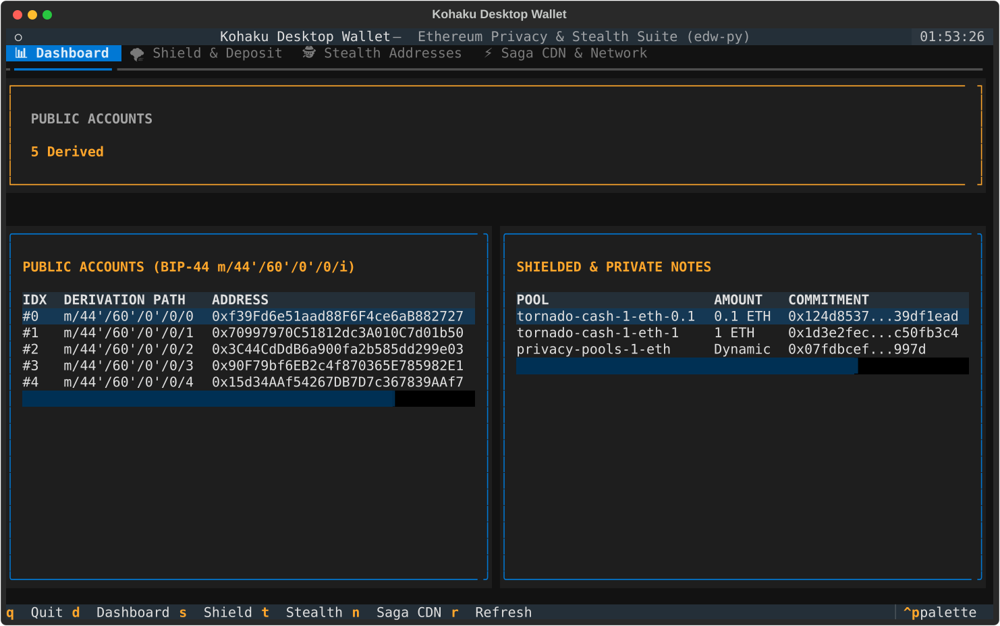

# kohaku-py 🦊⚡

Python privacy SDK & sovereign desktop wallet engine for Ethereum, bringing **Tornado Cash**, **Privacy Pools (0xBow)**, **Railgun (`0zk` UTXO Shielded Pool)**, **ERC-5564 Stealth Addresses**, and the **Saga Sync** protocol to pure Python.

Companion implementation to the Ethereum Foundation's **[ethereum/kohaku](https://github.com/ethereum/kohaku)** (TypeScript), **[ethereum/kohaku-rs](https://github.com/ethereum/kohaku-rs)** (Rust), and **[ethereum/desktop-wallet](https://github.com/ethereum/desktop-wallet)**.

---

## Terminal Desktop Wallet (TUI & CLI)

`kohaku-py` includes the full **`edw`** (Ethereum Desktop Wallet) sovereign engine in pure Python, complete with an interactive terminal UI and zero-leakage encrypted storage:

<p align="center">
  
</p>

Launch the interactive terminal wallet:
```bash
edw tui
# or
kohaku tui
```

---

## Key Features

- **Blinded Encrypted Datastore (`edw-core`)**:
  - Encrypted with **Argon2id** (64 MiB, 3 passes, 1 lane) and **ChaCha20-Poly1305** AEAD.
  - **Zero leakage on disk**: Record filenames are blinded with HKDF-SHA256 (`<blinded_hash>.bin`). An attacker inspecting disk sees zero accounts, zero notes, and zero history.
  - Fast password updates rewrites only `header.json` without re-encrypting records.
- **3-Layer Resilient Sync & Offline-First Snapshots (`kohaku.sync`)**:
  - **Offline-First Local Mode (`local_dir`)**: Reads pre-downloaded `.jsonl.gz` or decompressed `.jsonl` chunks directly from disk with zero network traffic.
  - **Automatic 3-Mirror Failover**: Seamlessly fails over across `saga.gordosoluciones.xyz` $\rightarrow$ `saga-pp-state.global.ssl.fastly.net` $\rightarrow$ `storage.googleapis.com/pp-state`.
  - **Direct L1 RPC Sync & On-Chain Root Verification**: Reconstructs Merkle trees directly from any Ethereum RPC node (`sync_from_rpc` via `eth_getLogs`) and verifies reconstructed Merkle roots against on-chain contracts (`isKnownRoot(bytes32)` on Tornado Cash; `currentRoot()` on 0xBow Privacy Pools).
- **On-Chain Tornado Relayer Registry & Live `/v1/status` Quoting (`kohaku.tornado.relayers`)**:
  - Reconstructs the on-chain `RelayerRegistry` (`0x58e8dcc13be9780fc42e8723d8ead4cf46943df2`), tracking `RelayerRegistered`, `StakeAddedToRelayer`, `StakeBurned`, and registered workers.
  - Resolves live relayer endpoints via EIP-137 ENS `text(node, "url")` on `mainnet-tornado.<ensName>` and probes `/v1/status` over HTTPS or Tor SOCKS5 (`edw relayers --probe`, `edw unshield --auto-relayer`).
- **Railgun Multi-Tree UTXO Engine & `0zk` Bech32m Addresses (`kohaku.railgun`)**:
  - Pure-Python **Bech32m (`0x2bc830a3`)** encoder/decoder for 73-byte `0zk1qy...` shielded addresses (`edw railgun address`).
  - Stateful multi-tree UTXO chainstate auditor (`RailgunVault`) supporting both Era 1 (`v1/v2.0`) and Era 2 (`v2.1+`) `RailgunSmartWallet` (`0xfa7093cdd9ee6932b4eb2c9e1cde7ce00b1fa4b9`) events (`Shield`, `Transact`, `Nullified`, `Unshield`) and pre-indexed `railgun-1-ops` `NxM` circuit topologies (`edw railgun audit`).
- **Extended ETH & ERC-20 Pools & Multi-Shield Bundling**:
  - Supports all 9 native ETH Tornado pools on Mainnet & Sepolia (`0.01`, `0.03`, `0.1`, `0.3`, `1`, `3`, `10`, `30`, `100` ETH) and all standard ERC-20 pools (**DAI** [100, 1k, 10k, 100k], **USDC** [100, 1k], **USDT** [100, 1k], **WBTC** [0.1, 1, 10]) with greedy token-decimal decomposition (`edw shield --token USDC --amount 1500`).
  - **Dual Multi-Shield Engine (`edw shield`)**: Bundles multi-note deposits into a single atomic ERC-4337 v0.8 `UserOperation` (`Simple7702Account.executeBatch` with automatic `approve(spender, amount)` + `deposit(commitment)` calls + signed EIP-7702 authorization) while simultaneously generating sequential EIP-1559 raw transactions for zero-bundler P2P/Tor fallback.
  - **ERC-20 Gasless Unshielding & Sponsorship (`edw unshield`)**: Requires an unspent shielded ETH note with paymaster to sponsor entrypoint gas fees, forward-calling `transfer(recipient, amount)` for pure zero-leakage token delivery.
  - **Smart Coin Selection**: Supports both `exact` denomination matching and largest-first `cover` note selection across held `MINED` notes.
- **Scriptable Automation & Password Files**:
  - Global `--password-file <path>` support across all commands for zero-prompt scripting, headless CI, and automated ops.
- **Anonymous Invoices (`edw-invoice:v1:...`) & Tor / SOCKS5 Tunneling**:
  - Native RFC 1928 SOCKS5 client in pure Python (`--tor-proxy 127.0.0.1:9050`).
- **Cross-Client Conformance Suite ([`conformance/`](conformance/README.md) & `edw conformance`)**:
  - Multi-language test vectors in JSON ensuring 100% bit-for-bit parity with Rust (`kohaku-rs`, `desktop-wallet`) and Circom across:
    - **Crypto**: MiMC-7 round constants, Poseidon, BabyJubJub Pedersen point compression, and LeanIMT dynamic trees.
    - **Notes & Invoices**: Exact commitment, nullifier hash derivation, and `edw-invoice:v1:...` URIs.
    - **Transactions**: Greedy splitting and ERC-4337 v0.8 `PackedUserOperation` EIP-712 hashes.
    - **Railgun & Storage**: 73-byte `0zk1qy...` Bech32m addresses and Argon2id + blinded HKDF disk paths.
  - See the complete [Conformance Specification & Guide](conformance/README.md) for how sibling clients consume these vectors.
- **Pure-Python Groth16 Codec & BN254 / BN128 Verifier (`kohaku.tornado.zk`)**:
  - **Sovereign Zero-External-Runtime**: 100% pure Python with **zero Node.js, zero npm, zero C++ bindings**.
  - Canonical point normalizers (`pad32`, `pad64`, `pad128`) and 256-byte ABI calldata packing expected by Tornado Cash `Verifier.sol` ($A \in G_1$ [64B], $B \in G_2$ [128B with EVM coordinate ordering], $C \in G_1$ [64B]).
  - Evaluates the Groth16 bilinear pairing equation $e(-A, B) \cdot e(\alpha, \beta) \cdot e(vk_x, \gamma) \cdot e(C, \delta) == 1_{G_T}$ over the BN128 curve in milliseconds using `py_ecc.bn128`.
  - Parsers for both SnarkJS and Arkworks JSON outputs, integrated into `edw unshield --dry-run` and `edw unshield --proof-file <path>`.
- **ZK Cryptography & Protocols**:
  - Pure Python BN254 scalar field arithmetic modulo $p$.
  - 220-round canonical MiMC-7 Sponge matching Tornado Cash on-chain contracts.
  - Circomlib-compatible Poseidon for 0xBow Privacy Pools and Railgun UTXO commitments.
  - 20-level binary Merkle Tree, LeanIMT (Privacy Pools), and 16-level multi-tree UTXO tracking (Railgun).
  - ERC-5564 Scheme 1 Stealth Meta-Addresses with secp256k1 ECDH.

---

## Installation

```bash
git clone https://github.com/rorupuntou/kohaku-py
cd kohaku-py

# With virtualenv
python -m venv .venv
source .venv/bin/activate  # or source .venv/bin/activate.fish
pip install -e .

# Or with Nix
nix develop
```

---

## EDW CLI Quickstart

```bash
# 1. Create a new encrypted wallet profile & rotate virgin addresses
edw profile new --name cypherpunk
edw next-fresh-address --peek

# 2. Multi-Shield arbitrary ETH or ERC-20 token (greedy decomposition + Dual EIP-7702 UserOp / EIP-1559)
edw shield --amount 33.34 --label "Vault-Deposit"
edw shield --token USDC --amount 1100 --label "USDC-Vault" --password-file /path/to/password.txt

# 3. Probe live on-chain Tornado Cash Relayers (/v1/status) & auto-select lowest fee on unshield
edw relayers --probe
edw unshield --amount 3.31 --to 0xVirginRecipient... --exact --auto-relayer
edw unshield --token USDC --amount 1100 --to 0xVirginRecipient... --password-file /path/to/password.txt

# 4. Encode / decode Railgun 0zk1... Bech32m addresses & audit Railgun UTXO chainstate
edw railgun address --decode 0zk1qy...
edw railgun audit --local-dir /path/to/saga-snapshots

# 5. Configure encrypted per-chain RPCs, ERC-4337 Bundlers, and Saga Indexer
edw network view
edw network bundler-add https://bundler.example.org/rpc

# 7. Verify cross-client canonical test vectors (100% spec parity)
edw conformance

# 8. Launch the interactive terminal UI
edw tui
```

---

## Empirical Ethereum L1 Privacy Protocol Audit

Using `kohaku-py`'s offline snapshot engine across the complete Saga state index, `kohaku-py` reproduces and verifies the full on-chain state of all three major Ethereum L1 ZK privacy protocols:

### 1. Tornado Cash On-Chain Relayer Registry (`0x58e8dcc13be9780fc42e8723d8ead4cf46943df2`)
- **Total Indexed Registry Events**: `164,887` (`124` registered relayers, `160,214` `StakeBurned` withdrawal relays).
- **Live Mainnet Relayers Verified via ENS (`mainnet-tornado.<ens>`) & `/v1/status`**:
  - `00relayer.eth` (`https://eth.00relayer.xyz`) — **0.360% fee** (`17,096.47 TORN` staked)
  - `safe-torn.eth` (`https://eth3.safetorn.ovh`) — **0.385% fee** (`26,388.00 TORN` staked)
  - `dieguis-and-martis.eth` (`https://mainnet.dieguis-and-martis.xyz`) — **0.390% fee** (`993.69 TORN` staked)
  - `tor-relay.eth` (`https://tor.fakkk.vin`) — **0.400% fee** (`1,464.19 TORN` staked)
  - `sky-relayer.eth` (`https://sky-relayer.xyz`) — **0.430% fee** (`14,083.79 TORN` staked)
  - `reltor.eth` (`https://eth.reltor.su`) — **0.460% fee** (`5,714.80 TORN` staked)

### 2. Railgun Smart Wallet (`0xfa7093cdd9ee6932b4eb2c9e1cde7ce00b1fa4b9`) Stateful UTXO Audit
- **Total Indexed UTXO Operations (`railgun-1-ops`)**: `144,326` (`131,284` shielded UTXO state transitions + `13,042` pure L1 unshields tagged with sentinel tree `0x1869f` / `99999`).
- **Multi-Tree Merkle State (Depth 16 = $65,536$ leaves/tree)**:
  - Trees `0`, `1`, `2`, `3`: **100% full** (`65,536` leaves each)
  - Tree `4` (active): **`30,961` leaves** (~47.2% capacity)
  - **Total UTXO Leaves Allocated**: `293,107` (`73,451` L1 `Shield` deposit notes + `219,656` `Transact` notes)
  - **Total Nullifiers Burned**: `256,451`
  - **Active Unspent UTXO Set**: **`36,656` live shielded UTXOs**
- **Dominant `NxM` Groth16 Circuit Topologies**:
  - `1x2`: `50,201` ops (34.8%) | `1x3`: `43,514` ops (30.1%) | `1x1`: `12,765` ops (8.8%) | `2x3`: `11,855` ops (8.2%) | `2x2`: `8,909` ops (6.2%) | `10x1` consolidation: `5,669` ops (3.9%).
- **Cumulative L1 Token Flows (`73,451` Shields vs. `103,689` Unshields across 50 chunks)**:

| Asset | Total Shielded In | Total Unshielded Out | Net Retained in Pool (TVL) |
| :--- | ---: | ---: | ---: |
| **WETH** | `620,351.09 WETH` | `593,084.80 WETH` | **`27,266.30 WETH`** |
| **USDT** | `420,256,889.84 USDT` | `389,307,641.36 USDT` | **`30,949,248.48 USDT`** |
| **USDC** | `314,270,980.04 USDC` | `290,043,982.05 USDC` | **`24,226,997.99 USDC`** |
| **DAI** | `203,924,567.61 DAI` | `196,669,965.79 DAI` | **`7,254,601.82 DAI`** |
| **WBTC** | `525.40 WBTC` | `490.95 WBTC` | **`34.45 WBTC`** |
| **wstETH** | `194.82 wstETH` | `48.61 wstETH` | **`146.21 wstETH`** |
| **RAIL** | `3,902,017.20 RAIL` | `3,409,424.78 RAIL` | **`492,592.42 RAIL`** |

---

## Python SDK Quickstart

### 1. Offline EIP-1559 Transaction Signing & Gasless Withdraw

```python
from kohaku.edw.tx_builder import TransactionBuilder
from kohaku.edw.tickets import Ticket

# Create an offline draft note
ticket = Ticket.create_draft(currency="ETH", amount="1", chain_id=1)

# Build a gasless withdrawal payload
payload = TransactionBuilder.build_gasless_withdraw_payload(
    ticket=ticket,
    recipient_address="0xVirginAddress...",
    merkle_root="0xRoot...",
    proof_bytes=proof_bytes,
    relayer_address="0xRelayerNode...",
    relayer_fee_eth=0.01,
)
print("Calldata ready:", payload.calldata)
print("Net ETH received by recipient:", payload.net_recipient_eth)
```

### 2. Encrypted Blinded Datastore

```python
from kohaku.edw.storage.database import EncryptedDatabase

# Open encrypted store
db = EncryptedDatabase.open("~/.edw/1", password="my-password")

# Write confidential key material (filename on disk is completely blinded)
db.set("vault:tornado", "note:0", b"secret-payload")

# Read back
secret = db.get("vault:tornado", "note:0")
```

### 3. Generate & Inspect Tornado Cash Notes & Live Relayer Quotes

```python
from kohaku.tornado import TornadoNote, TornadoVault
from kohaku.tornado.relayers import RelayerRegistryVault

note = TornadoNote.create(currency="ETH", amount="0.1", chain_id=1)
print("Note URI:", note.to_note_string())
print("Deposit Commitment:", note.commitment_hex)
print("Withdrawal Nullifier Hash:", note.nullifier_hash_hex)

# Probe active on-chain relayers (/v1/status) and select lowest fee
best_relayer = RelayerRegistryVault.select_best_relayer()
print("Best Relayer:", best_relayer.base_url, "Fee %:", best_relayer.service_fee_percent)
```

### 4. Railgun `0zk` Bech32m Addresses & Multi-Tree UTXO Audit

```python
from kohaku.railgun import RailgunAddress, RailgunVault
from kohaku.sync.client import SagaClient

# Encode / decode a 73-byte Railgun 0zk1qy... Bech32m address
addr = RailgunAddress.from_0zk("0zk1qy...")
print("Master Public Key:", hex(addr.master_public_key))

# Reconstruct multi-tree UTXO state from local snapshots or Saga CDN
vault = RailgunVault(client=SagaClient(local_dir="/path/to/snapshots", verify_checksum=False))
vault.sync_ops()
vault.sync_events()
print(vault.utxo_audit_summary())
```

---

## Pure Python Groth16 ZK Verification & Codec

`kohaku-py` features a **100% pure Python** Groth16 zk-SNARK codec and bilinear pairing verifier over the BN254 / BN128 curve with **zero Node.js, zero npm, zero snarkjs, and zero C++ runtime dependencies**.

### How It Works

1. **Canonical Point Normalization & ABI Packing (`kohaku.tornado.zk.codec`)**:
   - Curve points are normalized with `pad32` (scalars), `pad64` ($G_1$ points: $(X, Y)$), and `pad128` ($G_2$ points).
   - Packs proof points into the exact **256-byte** format expected by Tornado Cash `Verifier.sol` and the EVM `0x08` pairing precompile:
     - $A \in G_1$: 64 bytes
     - $B \in G_2$: 128 bytes (with $(c_1 \text{ real}, c_0 \text{ imag})$ coordinate order for EVM compatibility)
     - $C \in G_1$: 64 bytes
   - Direct loaders for both **SnarkJS** (`pi_a`, `pi_b`, `pi_c`) and **Arkworks** formats.

2. **Offline Bilinear Pairing Verifier (`kohaku.tornado.zk.verifier`)**:
   - Uses `py_ecc.bn128` to evaluate the pairing product equation in $G_T$:
     $$e(-A, B) \cdot e(\alpha_1, \beta_2) \cdot e(vk_x, \gamma_2) \cdot e(C, \delta_2) == 1_{G_T}$$
     where $vk_x = IC[0] + \sum_{i} (IC[i+1] \cdot \text{pub}_i)$ computes the public signal linear combination.
   - Executes in $<0.4\text{s}$ locally in pure Python.

### Python API Example

```python
import json
from kohaku.tornado.zk import Groth16Proof, verify_groth16_proof

# 1. Parse proof from SnarkJS JSON
with open("proof.json") as f:
    snarkjs_data = json.load(f)

proof = Groth16Proof.from_snarkjs_dict(snarkjs_data)
raw_calldata_bytes = proof.to_bytes()  # Exactly 256 bytes
print("Solidity proof calldata:", proof.to_hex())

# 2. Verify Groth16 proof offline in pure Python
with open("verification_key.json") as f:
    vk = json.load(f)
public_signals = ["0x1234...", "0x5678..."]

is_valid = verify_groth16_proof(proof, public_signals, vk)
print("Proof valid:", is_valid)  # True
```

### CLI Simulation & Custom Proofs

```bash
# Dry-run unshield with synthetic 256-byte Groth16 proof
edw unshield --amount 0.1 --token ETH --to 0xRecipient... --dry-run

# Unshield using an explicit Groth16 proof file
edw unshield --amount 0.1 --token ETH --to 0xRecipient... --proof-file /path/to/proof.json
```

---

## Test Suite

```bash
pytest -v
```

```
tests/test_conformance.py::test_conformance_crypto_primitives PASSED     [  1%]
tests/test_conformance.py::test_conformance_tornado_notes PASSED         [  3%]
tests/test_conformance.py::test_conformance_invoices PASSED              [  5%]
tests/test_conformance.py::test_conformance_multishield_userop PASSED    [  7%]
tests/test_conformance.py::test_conformance_railgun PASSED               [  9%]
tests/test_conformance.py::test_conformance_blinded_storage PASSED       [ 11%]
tests/test_conformance.py::test_conformance_verify_all PASSED            [ 13%]
tests/test_crypto.py::test_mimc_constants PASSED                         [ 15%]
tests/test_crypto.py::test_tornado_zero_value_propagation PASSED         [  4%]
tests/test_crypto.py::test_poseidon PASSED                               [  6%]
tests/test_crypto.py::test_pedersen_hash_kohaku_rs_parity PASSED         [  9%]
tests/test_edw_cli.py::test_edw_cli_full_workflow PASSED                 [ 11%]
tests/test_edw_cli.py::test_edw_cli_shield_unshield_and_network PASSED   [ 13%]
tests/test_edw_cli.py::test_edw_cli_erc20_shield_and_unshield PASSED     [ 15%]
tests/test_edw_p2p.py::test_socks5_handshake_mock_server PASSED          [ 18%]
tests/test_edw_p2p.py::test_socks5_domain_atyp3_no_dns_leak_and_short_reads PASSED [ 20%]
tests/test_edw_p2p.py::test_p2p_broadcaster_with_failover PASSED         [ 22%]
tests/test_edw_p2p.py::test_dispatch_gasless_withdrawal PASSED           [ 25%]
tests/test_edw_storage.py::test_blinded_cipher_lifecycle PASSED          [ 27%]
tests/test_edw_storage.py::test_encrypted_database_disk_zero_leakage PASSED [ 29%]
tests/test_edw_storage.py::test_keyring_manager_and_fresh_address_rotation PASSED [ 31%]
tests/test_edw_tickets.py::test_ticket_draft_and_invoice_generation PASSED [ 34%]
tests/test_edw_tickets.py::test_ticket_manager_encrypted_lifecycle PASSED [ 36%]
tests/test_edw_tickets.py::test_multi_shield_and_coin_selection PASSED   [ 38%]
tests/test_edw_tx_builder.py::test_eip1559_transaction_signing_and_recovery PASSED [ 40%]
tests/test_edw_tx_builder.py::test_build_deposit_transaction PASSED      [ 43%]
tests/test_edw_tx_builder.py::test_gasless_withdraw_payload_and_relayer_broadcast PASSED [ 45%]
tests/test_edw_tx_builder.py::test_dual_multi_shield_bundle PASSED       [ 47%]
tests/test_edw_tx_builder.py::test_packed_user_operation_v08_eip712_hash_kohaku_rs_vector PASSED [ 50%]
tests/test_edw_tx_builder.py::test_erc20_multi_shield_bundle_and_forward_call PASSED [ 52%]
tests/test_groth16_zk.py::test_point_padding PASSED                      [ 54%]
tests/test_groth16_zk.py::test_groth16_proof_serialization PASSED        [ 56%]
tests/test_groth16_zk.py::test_groth16_snarkjs_parsing_and_equivalence PASSED [ 57%]
tests/test_groth16_zk.py::test_groth16_arkworks_parsing PASSED           [ 59%]
tests/test_groth16_zk.py::test_groth16_pure_python_verification PASSED   [ 61%]
tests/test_groth16_zk.py::test_build_withdraw_transaction_with_groth16_proof PASSED [ 63%]
tests/test_merkle.py::test_merkle_tree_proofs PASSED                     [ 64%]
tests/test_merkle.py::test_lean_imt_dynamic_tree_and_proofs PASSED       [ 56%]
tests/test_privacy_pools.py::test_privacy_pool_note PASSED               [ 59%]
tests/test_privacy_pools.py::test_association_set PASSED                 [ 61%]
tests/test_privacy_pools.py::test_privacy_pools_registry PASSED          [ 63%]
tests/test_privacy_pools.py::test_saga_v2_event_and_ed25519_manifest_signature PASSED [ 65%]
tests/test_privacy_pools.py::test_local_dir_sync_and_onchain_root_verification PASSED [ 68%]
tests/test_railgun.py::test_railgun_0zk_bech32m_address_roundtrip PASSED [ 70%]
tests/test_railgun.py::test_railgun_vault_operations_and_events PASSED   [ 72%]
tests/test_stealth.py::test_stealth_keypair_derivation PASSED            [ 75%]
tests/test_stealth.py::test_erc5564_scheme1_lifecycle PASSED             [ 77%]
tests/test_tornado.py::test_tornado_note_creation_and_parsing PASSED     [ 79%]
tests/test_tornado.py::test_tornado_pools PASSED                         [ 81%]
tests/test_tornado.py::test_keychain_derivation PASSED                   [ 84%]
tests/test_tornado.py::test_deposit_transactions PASSED                  [ 86%]
tests/test_tornado.py::test_circuit_inputs_and_withdraw_transaction PASSED [ 88%]
tests/test_tornado.py::test_relayer_registry_vault_and_ens_resolution PASSED [ 90%]
tests/test_tornado.py::test_relayer_status_quote_and_auto_selection PASSED [ 93%]
tests/test_tornado.py::test_erc20_token_catalog_selection_units_and_denominations PASSED [ 95%]
tests/test_tornado.py::test_erc20_withdrawals_do_not_mix_assets_and_require_eth_sponsor PASSED [ 97%]
tests/test_tui.py::test_tui_app_mount_and_headless PASSED                [ 98%]
tests/test_tui.py::test_tui_interactive_wallet_lifecycle PASSED          [100%]

============================= 58 passed in 31.66s ==============================
```

---

## License

MIT License. Designed for privacy, sovereignty, and research.

